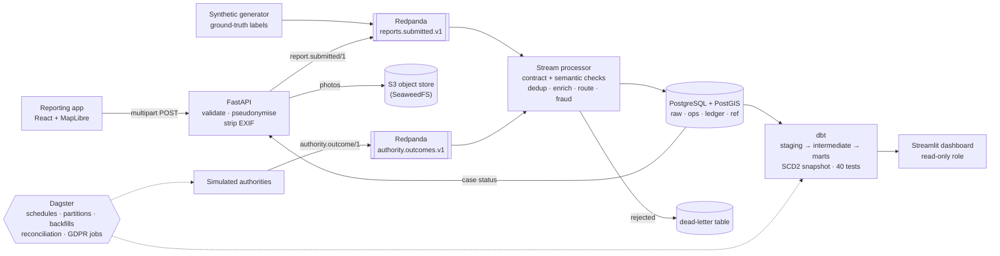
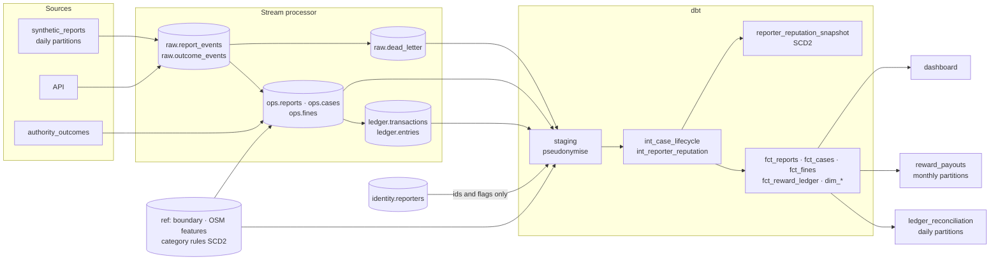
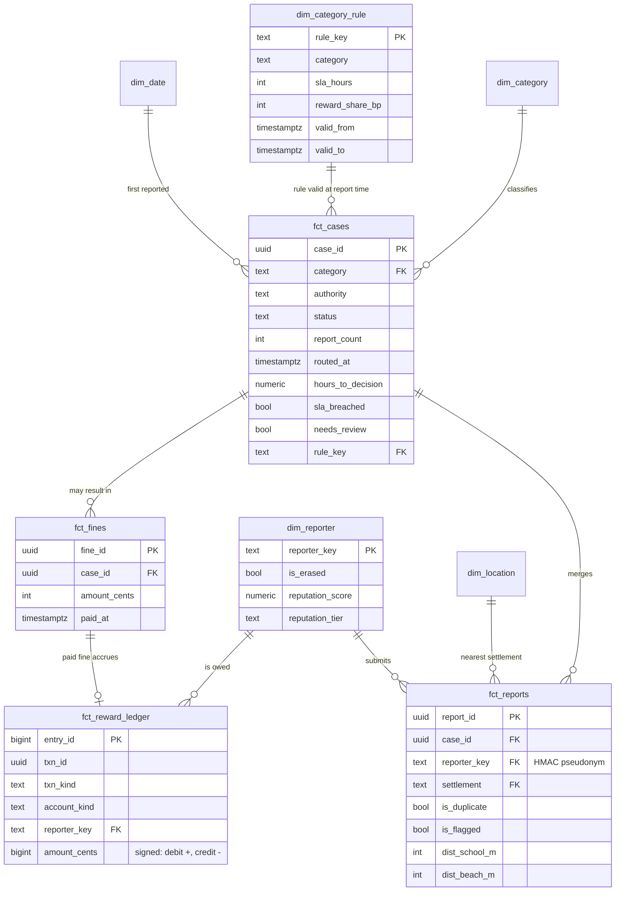
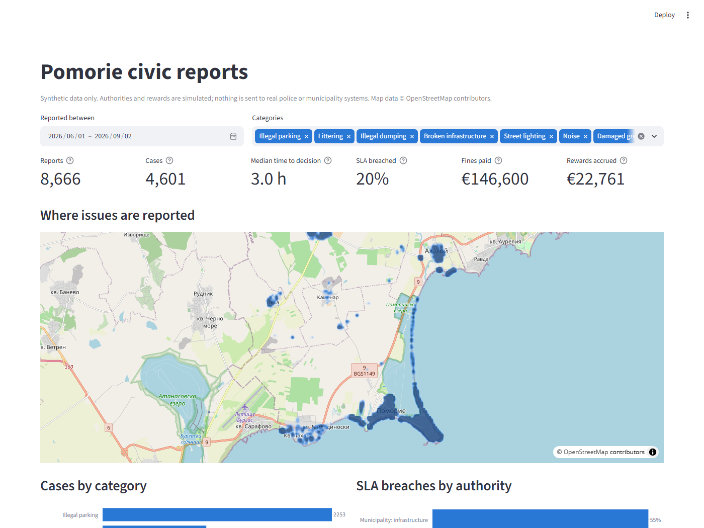

# Pomorie Reports: a civic data platform

**A streaming and batch data platform that turns residents' reports from Pomorie, Bulgaria into validated, deduplicated, routed cases, a tested dbt warehouse and an auditable reward ledger.**

Python · SQL · Kafka (Redpanda) · PostgreSQL + PostGIS · dbt · Dagster · data contracts (JSON Schema) · data quality tests · GDPR by design · FastAPI · Docker Compose · GitHub Actions


> All data is synthetic. Police and municipality systems are simulated; nothing is sent to a real authority, and the reward ledger moves no real money.



## The problem

Residents notice illegally parked cars, rubbish on the beach, broken street lights and night-time noise long before an inspector does, but reporting means a phone call to the right office. A reporting app is the easy part. The hard part is the data behind it: the same pothole reported by twelve people, GPS fixes in the sea, a neighbour reporting the same car every day, and a promise to share part of each fine with the reporter, which needs books that balance. This project is that data platform. The app exists to produce the data and to show reporters what happened to their report.

## What it does

- **Ingestion.** The API validates each report, HMAC-hashes licence plates, re-encodes photos to strip EXIF (GPS position, device), stores them in S3 and publishes a versioned event to Kafka. Retries with the same `Idempotency-Key` count once.
- **Data contracts.** JSON Schemas in [`contracts/`](contracts/) are checked by the producer and the consumer. CI fails a pull request that changes a published schema in a breaking way ([`compat.py`](src/pomorie/contracts/compat.py)).
- **Validation.** Contract failures, unparsable messages and reports that make no sense (outside the municipality, timestamps in the future, older than 7 days, GPS accuracy worse than 250 m) go to a dead-letter table with every reason.
- **Deduplication.** Reports of the same issue are merged into one case with a per-category distance and time window, searched in PostGIS.
- **Geospatial enrichment.** Nearest settlement, street, landmark, and distance to the nearest school and beach, from OpenStreetMap.
- **Routing.** Category rules decide the authority and SLA deadline. The rules are versioned (type 2), so a case is always judged by the rule that was valid when it was reported.
- **Fraud checks.** Reporting bursts, impossible travel between reports, the same reporter targeting the same plate, and low reputation. A flag holds the case for manual review; no reward is accrued until a reviewer approves it.
- **Reward ledger.** Append-only and double-entry, enforced by Postgres triggers. Rewards are accrued only when a fine is paid. A daily reconciliation recomputes what should have been paid and fails loudly on any mismatch.
- **Warehouse.** dbt models in three layers with an SCD2 snapshot of reporter reputation, 40 data tests and source freshness checks.
- **Orchestration.** Dagster assets with daily and monthly partitions, idempotent backfills, retries with backoff, schedules, asset checks and failure alerts.
- **Privacy.** Identity is stored apart from report data; analytics use HMAC pseudonyms; erasure requests propagate through every layer; retention jobs delete photos and free text on schedule; the dashboard runs as a role that cannot read personal data.
- **Serving.** A Streamlit dashboard for the city and a status endpoint for the reporter.

## Tech stack

| Layer | Technology | What it does here |
|---|---|---|
| Streaming | **Redpanda** (Kafka API), confluent-kafka | Two topics, keyed for per-category ordering, 7-day retention |
| Operational store | **PostgreSQL 16 + PostGIS 3.4** | Raw landing, cases, ledger, reference data; spatial search |
| Warehouse | **dbt** (dbt-postgres) | Staging → intermediate → marts, SCD2 snapshot, data tests |
| Orchestration | **Dagster** + dagster-dbt | Software-defined assets, partitions, schedules, sensors |
| API | **FastAPI**, Pydantic | Ingestion and the reporter's status endpoint |
| Object storage | S3 API via boto3 (**SeaweedFS** locally) | EXIF-stripped photos |
| Geodata | OpenStreetMap (Geofabrik extract), **pyosmium**, **Shapely** | Boundary and enrichment features |
| Dashboard | **Streamlit**, Plotly | City analytics from the marts only |
| App | React, TypeScript, Vite, Tailwind, **MapLibre GL** | Map-based reporting, no paid map key |
| Quality | **pytest**, **Ruff**, **mypy** (strict), **SQLFluff**, ESLint | One command each, all in CI |
| Delivery | **Docker Compose**, **GitHub Actions**, uv | One-command local stack, CI on every push |

## Design decisions and trade-offs

### Stream for operations, batch for analytics

A report must be routed to an authority within seconds; the city's analytics can be an hour old. So the stream processor does everything a case needs (validate, deduplicate, enrich, route, flag) as events arrive, and Dagster runs everything batch: dbt, simulated authorities, payouts, reconciliation and GDPR jobs. The processor writes plain Postgres tables, which dbt reads as sources and Dagster shows as external assets, so the lineage graph runs from the generator to the marts without pretending Dagster runs the stream.

**Delivery guarantee.** Kafka offsets are committed only after the database transaction commits. A crash in between redelivers the event, and the raw insert is keyed by `event_id`, so the second copy is recognised and skipped. That is at-least-once delivery made effectively exactly-once by idempotent writes. Messages are processed in micro-batches: one transaction per batch, one savepoint per message, so a rejected event goes to the dead-letter table without affecting its neighbours. A batch that fails is replayed one message at a time with retries, which isolates a poison message ([`consumer.py`](src/pomorie/processing/consumer.py)).

**Event time, not wall-clock time.** Windows, rule versions and ledger dates use the time the report was received, not the time it was processed. Replaying three months of history therefore produces the same cases and the same ledger as live processing would have, and Dagster backfills are deterministic: the generator seeds its random numbers per day, so re-running a partition republishes identical event ids, which are skipped.

**Why Kafka and not a Postgres outbox.** One database plus an outbox table would be simpler and enough at Pomorie's volume (about 100 reports a day). Kafka buys decoupling (the API keeps accepting reports while the database is down), replay, and a second consumer later (for example, an image classifier) without touching the API. Redpanda speaks the Kafka protocol in one container without ZooKeeper.

### Deduplication

Each report is compared with open cases of the same category ([`dedup.py`](src/pomorie/processing/dedup.py)):

1. **Candidates** are cases within the category's radius, found with `ST_DWithin` on a GiST index.
2. **Active cases** are those whose last report is within the category's time window (a sliding window), and that are not older than 4 windows in total. The cap stops a spot where people park illegally every day from merging weeks of separate offences into one case.
3. **The nearest active case wins**; with none, the report opens a new case.

Radius and window differ by category: a parked car is gone in hours and sits exactly where it was reported (30 m, 3 h), noise is heard from 150 m away, and a pothole stays for weeks (25 m, 30 days). The trade-off is precision against recall: two different issues close together merge, and a report with poor GPS can miss its case. Both are measured below against the generator's ground truth.

**Ordering without locks.** Reports are keyed by category, so one partition, and one consumer, handles all reports of a category in order. Two reports of the same pothole can never race to create two cases. The cost is parallelism: the busiest category (illegal parking, about half of all cases) bounds throughput. The next step would be keying by category plus a geohash cell, with neighbouring cells checked at the edges.

### The reward ledger

```
fine paid:   reward_expense       +R      payable:<reporter>  −R      (accrual, dated when the fine was paid)
month end:   payable:<reporter>   +B      payout_cash         −B      (simulated payout)
```

- **The rules live in the database, not only in Python.** A deferred constraint trigger rejects any transaction whose entries do not sum to zero; `UPDATE`, `DELETE` and `TRUNCATE` on entries raise an error (corrections are new reversing transactions); a partial unique index allows exactly one accrual per fine, so a fine-paid event delivered twice cannot pay twice ([`006_ledger.sql`](sql/migrations/006_ledger.sql)).
- **The reward** is `floor(fine × share)`, using the category rule valid when the case was first reported, so a later rule change never alters an earlier promise. It goes to the first reporter whose report was not flagged.
- **Daily reconciliation** recomputes the expected rewards from fines and rules, independently of the ledger code, and fails the Dagster run when they disagree ([`reconciliation.py`](src/pomorie/reconciliation.py)). The dbt tests check the same invariants from the warehouse side.

### Privacy (GDPR)

| Principle | How it is implemented |
|---|---|
| Data minimisation | Events carry a random `reporter_id`, never a name or e-mail; the contract forbids unknown fields. |
| Separation | Names and e-mails live only in `identity.reporters`. |
| Pseudonymisation | Plates are HMAC-SHA256 hashed in the API (an unkeyed hash of an enumerable plate format can be reversed); the warehouse replaces `reporter_id` with an HMAC in staging, the only place it is read. |
| Photos | Re-encoded to drop EXIF (GPS, device); only object keys enter events and tables. |
| Least privilege | The dashboard connects as a role that can read the `analytics` schema only; reading `identity` fails with "permission denied". |
| Erasure (Art. 17) | One request removes name and e-mail, photos, free-text descriptions (also inside stored raw payloads) and dead-lettered copies; the next dbt build propagates it to every mart; Kafka copies expire after 7 days ([`gdpr.py`](src/pomorie/gdpr.py)). |
| Retention (Art. 5) | Photos deleted 90 days after a case closes, descriptions after a year, plate hashes after 180 days, dead letters after 30 days. |
| What is kept, and why | Category, place and time (needed to run the city's cases; without the identity they no longer point to a person) and the ledger, a financial record the municipality must keep (Art. 17(3)(b)), which references only a pseudonymous id. |

### Other choices

- **PostgreSQL as the warehouse.** The marts need the same spatial functions as the processor, and the volume fits one instance. With more data or more analysts, the same dbt project would move to BigQuery or Snowflake, with PostGIS logic replaced by the warehouse's GIS functions.
- **Reference data from a Geofabrik extract, not the Overpass API.** The public Overpass server asks automated clients to go elsewhere and was returning 502s. The ~180 MB Bulgaria extract is read once with pyosmium; the 180 KB result is committed, so builds need no network.
- **SeaweedFS for S3.** MinIO stopped publishing community images. The code uses plain boto3, so AWS S3 is a configuration change.
- **A 100 m coastal tolerance on the boundary.** The municipal boundary is the coastline, so a report from the waterline or a pier with normal GPS error lands "in the sea". See the findings below.

## Measured results

Measured on Windows 11 with Docker Desktop (16 CPUs, 8 GB for Docker), with 92 days of generated history (1 June – 31 August 2026).

| What | Result | Command |
|---|---|---|
| Events generated and processed | 8,968 events → 8,666 accepted, 302 dead-lettered, 4,601 cases | `docker compose run --rm demo` |
| Validation | 193/193 bad-GPS and 43/43 stale reports rejected; 0 of 7,944 genuine reports rejected | `python -m pomorie.evaluation` |
| Deduplication (pairwise) | precision **0.759**, recall **0.972** | `python -m pomorie.evaluation` |
| Fraud flags | precision **0.997**, recall **0.795** (576 flagged of 722 abusive) | `python -m pomorie.evaluation` |
| Latency, report submitted → case routed | p50 **69 ms**, p95 101 ms, p99 123 ms at 20 reports/s for 60 s | `python -m pomorie.bench latency --rate 20 --seconds 60` |
| API response time | p50 75 ms, p95 105 ms (includes the Kafka acknowledgement) | same |
| Processor throughput | **62 reports/s** with 1 consumer, **88 reports/s** with 4 (11,066 reports, identical 5,446 cases) | `scripts/bench_throughput.sh 1`, `… 4` |
| Warehouse build | 21 models + 1 snapshot + 40 tests in **6.9 s**; 40/40 tests pass | `cd dbt && dbt build`, then `python -m pomorie.bench dbt` |
| Ledger reconciliation | 153/153 days pass; ledger sums to 0 over 2,986 entries | `python -m pomorie.reconciliation <day>` |
| Test suite | 73 pytest tests (unit + integration against the real services) | `pytest` |

How to read these numbers:
- **Throughput** is far above need. Pomorie generates about 100 reports a day; one consumer handles about 5 million. The 4-consumer run is limited by the busiest partition (illegal parking), as explained under deduplication.
- **Fraud precision of 0.997** only says the rules catch the abuse patterns I generated. Real abuse is messier, and this number would drop on real data.
- **Dedup thresholds were tuned on generated labels**, so a real launch would need a labelled sample of real reports.

### What the measurements caught

Every one of these was found by running the pipeline and measuring, not by reading the code:

1. **4.8 % of genuine reports were rejected** on the first full run. The boundary is the coastline, so beach and pier reports with ordinary GPS error landed a few metres "in the sea". A 100 m tolerance zone, buffered in metres rather than degrees, brought genuine rejections to 0 while bad fixes kilometres out are still rejected.
2. **Dedup precision was 0.44.** Litter is cleaned daily, but the 72-hour window merged separate litter on the same beach into one case of 32 reports. A 12-hour window raised precision to 0.80 with recall unchanged (on the generator version of the time; the current figure is above).
3. **Fraud recall was 0.59**, because a burst is only visible at its sixth report. Rewards are paid when a fine is paid, often days later, so once a pattern is detected the earlier reports in it are held too. Recall rose to 0.83 at the same precision.
4. **Latency was 1,091 ms at p50.** The consumer waited up to a second for a batch of 500 that never filled at normal traffic. Waiting at most 50 ms once the first message arrives brought it to 69 ms.
5. **Throughput was 28 reports/s.** Profiling showed about 2 ms per round trip through Docker Desktop's port forwarding and 3 ms per commit fsync. Running in the Compose network, one fraud query instead of three, cached rules, a stored geography column and micro-batching took it to 62 reports/s.
6. **Four consumers were no faster than one.** Redpanda had auto-created the reports topic with one partition before setup ran. Auto-creation is now disabled, and setup fails if a topic has the wrong partition count.
7. **The reconciliation failed on its first run**, correctly. Rewards were dated by wall-clock time while everything else used event time, so a payout for a backfilled day found nothing. Accruals are now dated when the fine was paid.

## Data lineage



## Data model (marts)



## The dashboard



It shows the issue heatmap, cases by category, SLA breaches and median decision time per authority, weekly volume, fines paid against rewards accrued, repeat hotspots and input quality. [Full page](docs/images/dashboard_full.png).

## Run it

Needs Docker with Compose v2. Everything else runs in containers.

```bash
git clone https://github.com/<you>/pomorie-reports.git && cd pomorie-reports
docker compose up -d                 # Postgres/PostGIS, Redpanda, S3, API, processor, Dagster, dashboard, app
docker compose run --rm demo         # seed 3 months of synthetic history (about 3 minutes)
```

| Open | URL |
|---|---|
| Reporting app | http://localhost:5173 |
| City dashboard | http://localhost:8501 |
| Dagster (assets, lineage, runs) | http://localhost:3030 |
| API docs (OpenAPI) | http://localhost:8000/docs |
| Redpanda console (topics, messages) | http://localhost:8080 (`docker compose up -d redpanda-console`) |

Settings come from environment variables with local defaults; see [`.env.example`](.env.example). Postgres listens on host port 55432 to avoid clashing with a local Postgres.

## Tests and checks

```bash
uv sync                                    # Python 3.12 environment from uv.lock
docker compose up -d postgres redpanda seaweedfs
uv run pytest                              # 73 tests; integration tests skip if the services are down
uv run ruff check . && uv run ruff format --check . && uv run mypy
uv run sqlfluff lint dbt/models dbt/tests
cd dbt && DBT_PROFILES_DIR=. uv run dbt build
```

GitHub Actions ([`ci.yml`](.github/workflows/ci.yml)) runs all of this on every push. It also checks the data contracts against the previous commit, seeds a week of data through the real pipeline, runs `dbt build`, reconciles the ledger and builds the Docker image.

## Project structure

```
contracts/            JSON Schemas for the two event types (the data contracts)
sql/migrations/       Forward-only schema migrations (raw, ops, ledger, identity, ref, eval)
src/pomorie/
  api/                FastAPI ingestion and status endpoints
  processing/         Stream processor: validation, dedup, enrichment, fraud, ledger postings
  orchestration/      Dagster assets, schedules, sensors
  generator/          Synthetic report generator with ground-truth labels
  simulation/         Simulated police and municipality decisions
  reference/          OSM boundary and feature extraction, reference data loader
  dashboard/          Streamlit city dashboard
  gdpr.py             Erasure and retention
  reconciliation.py   Daily ledger reconciliation
  evaluation.py       Dedup and fraud metrics against ground truth
  bench.py            Latency and dbt benchmarks
dbt/                  Staging, intermediate and mart models, snapshot, data tests
app/                  React + TypeScript reporting app
tests/                pytest: unit and integration tests
data/reference/       Committed OSM extract, boundary and category rules
```

## Limits and what I'd do next

- **Legal basis for rewards.** Sharing part of a fine with the reporter is simulated here. A real launch would need the legal basis confirmed with the municipality and a lawyer, along with a payment provider and identity checks for payouts.
- **Authentication.** The app registers a demo reporter and the review endpoints use a shared token. A real deployment would use the municipality's identity provider (OIDC) with reporter and reviewer roles.
- **Partitioning by place.** Keying by category plus a geohash cell would remove the hot-partition limit on throughput.
- **Image classification.** A model that suggests the category from the photo would cut miscategorised reports. It would be a second Kafka consumer, with no change to the API.
- **A cloud deployment.** The same images on a managed Kafka, a managed Postgres and S3, with infrastructure as code (Terraform) and the warehouse moved to BigQuery.
- **A municipality pilot** with real, consented reports, to re-tune the dedup windows and fraud thresholds on real labels.

## Licence and attribution

Code under the [MIT licence](LICENSE). Map data and reference features © [OpenStreetMap](https://www.openstreetmap.org/copyright) contributors, available under the Open Database Licence (ODbL); the derived files in `data/reference/` carry that attribution and are shared under the same licence.
